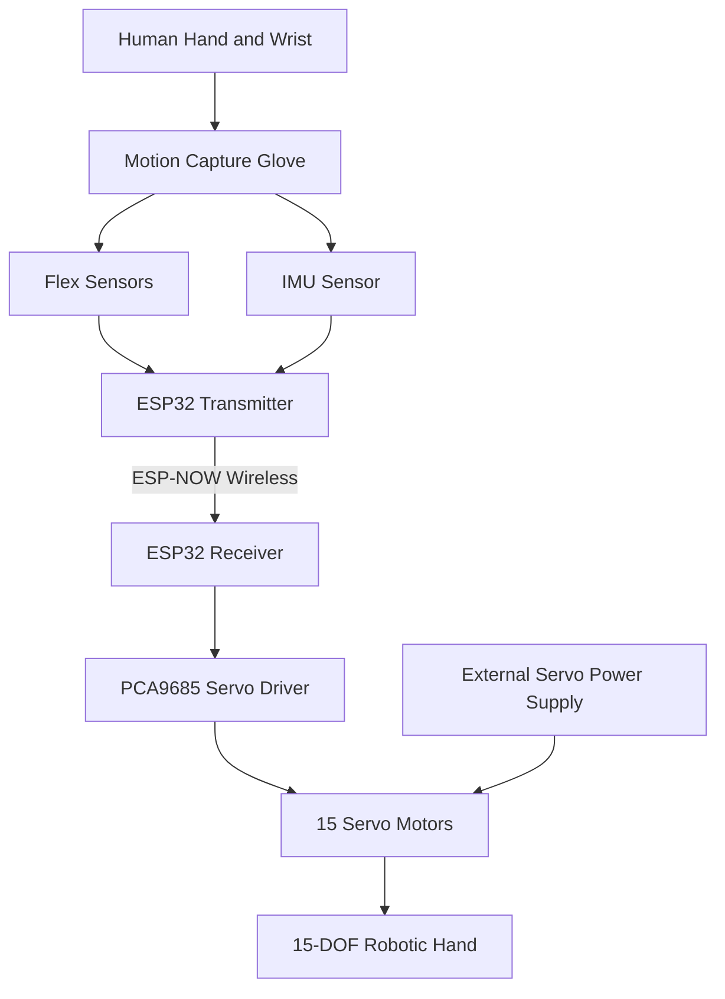

# System Architecture

## 1. Overview

The 15-DOF Robotic Hand Motion Control system is designed to reproduce human hand and wrist movements using a wearable motion capture glove and a servo-driven robotic hand.

The system consists of two main units:

- **Motion Capture Glove:** Measures finger bending and wrist orientation.
- **Robotic Hand:** Receives the captured motion data and reproduces the movements using 15 servo motors.

An ESP32-based wireless communication system connects both units.

## 2. System Architecture Diagram



## 3. Main System Components

### 3.1 Motion Capture Glove

The wearable glove captures human hand movements through:

- Flex sensors to measure finger bending.
- IMU sensor to measure wrist orientation.
- ESP32 microcontroller to process and transmit sensor data.

### 3.2 Wireless Communication

The glove transmits motion data to the robotic hand using ESP-NOW.

This communication method allows both ESP32 boards to exchange data without requiring a Wi-Fi router.

### 3.3 Robotic Hand Controller

The receiving ESP32 processes the incoming motion data and converts it into servo position commands.

A PCA9685 PWM driver generates the control signals for the servo motors.

Two PCA9685 boards may be used to provide enough channels for all 15 servos.

### 3.4 Robotic Hand

The robotic hand uses 15 servo motors to reproduce human hand and wrist movements.

The proposed 15 degrees of freedom are distributed as follows:

| Joint Group | Degrees of Freedom |
|---|---:|
| Thumb | 2 |
| Index Finger | 3 |
| Middle Finger | 3 |
| Ring Finger | 3 |
| Little Finger | 3 |
| Wrist | 1 |
| **Total** | **15** |

This distribution is a preliminary mechanical design and must be validated during prototyping.

## 4. Power Architecture

The system uses separate power arrangements for the control electronics and servo motors.

- The ESP32 boards and sensors receive regulated power.
- The servo motors receive power from a dedicated external supply.
- The servo driver and controller must share a common ground.
- The servo supply must be dimensioned according to the motors' voltage and current requirements.

The servo motors must not be powered directly from the ESP32.

## 5. Data Flow

1. The user moves their hand and wrist.
2. Flex sensors measure finger bending.
3. The IMU measures wrist orientation.
4. The glove ESP32 reads and processes sensor data.
5. Motion data is transmitted wirelessly.
6. The robotic hand ESP32 receives the data.
7. Servo positions are calculated.
8. The PCA9685 drivers control the 15 servo motors.
9. The robotic hand reproduces the captured movements.

## 6. Design Considerations

- Low-latency wireless communication.
- Accurate sensor calibration.
- Smooth servo movement.
- Independent servo power supply.
- Mechanical joint alignment.
- Protection against excessive servo movement.
- Emergency stop capability.

## 7. Development Status

The architecture represents the proposed system design.

Hardware selection, electrical connections, servo mapping and communication performance must be tested and validated during implementation.
```

## 3. Guardar no GitHub

Na mensagem do commit escreve:

```text
Add system architecture diagram
```

Depois clica em **Commit changes**.

<badge color="success">Próximo passo</badge> 

Quando terminares envia-me um print. Vamos avançar para `glove-circuit.md`, onde vamos desenhar as ligações dos sensores da luva.

**Nota importante:** a distribuição dos 15 servos fica definida como proposta inicial. Ainda teremos de confirmar se a mecânica consegue reproduzir esses movimentos.
